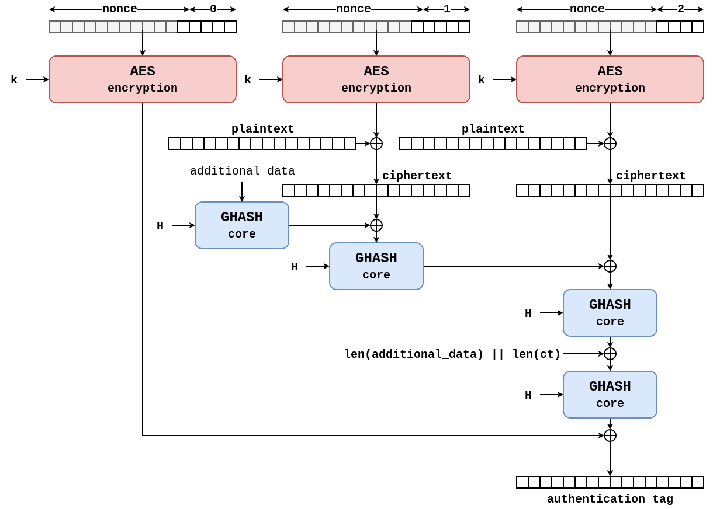
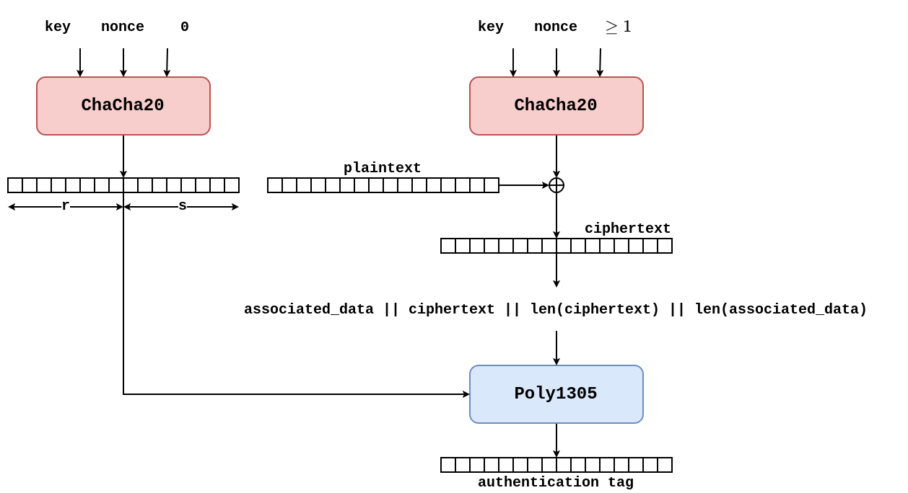

# Authenticated Encryption

## Block cipher
Un block cipher può essere visto come una permutazione (bit level) di un plaintext. È possibile mappare plaintext e ciphertext utilizzando la chiave segreta.
=> **PRP**: pseudorandom permutation

AES ha una **round function** che viene ripetuta *n* volte, per ogni round function viene generata una **round key** attraverso un **key schedule**. Il più piccolo cambiamento di bit nella chiave genera uno stravolgimento del ciphertext (**principio di diffusione**). La round function di AES è composto da quattro procedure: SubBytes, ShiftRows, AddRoundKey e MixColumn. Tutte queste procedure sono reversibili ad eccezione di `AddRoundKey` che è uno XOR bit a bit con la *round key*.

AES-128 con 3 round permette la rottura efficente del cifrario. Iterando più volte la round function sul plaintext questo viene trasformato in qualcosa che sembra testo randomizzato, la modifica anche solo di un singolo bit nel plaintext genera un output completamente diverso => *avalanche effect*.

AES-NI: set di istruzioni per eseguire in maniera ottimizzata AES su HW.

### Padding
Se `len(pt) >= BLOCK_SIZE` => allora è necessario un meccanismo che allinei il pt ad un multiplo della BLOCK_SIZE, questo compito è svolto dal **padding** (lo standard per la crittografia è lo standard PCKS#7), e ci servirà un modo per concatenare i ciphertext parziali, risolto dal **mode of operation**.

**PCKS#7**: il valore di ogni byte di padding deve essere impostato al valore della lunghezza del padding richiesto.

### Modes of Operation
* **ECB**: electronic codebook => mantiene il significato, vedi ECB penguin

* **CBC**: cipher chaining mode => introduzione dell'IV per rendere la cifratura "meno deterministica". l'**initialization vector** deve essere **unico** e **impredicibile** (random). vedi [**BEAST (Browser Exploit Against SSL/TLS) attack**](https://www.invicti.com/blog/web-security/how-the-beast-attack-works)


Per prevenire modifiche all'integrità del dato `m = iv || ct` possiamo usare il MAC: `AES-CBC-HMAC` è importante utilizzare il costrutto *Encrypt-than-MAC`, altri costrutti, come il *MAC-than-Encrypt`, possono portare a degli attacchi (come il famoso **Vaudenay Padding Oracle Attack**) => `m = iv || ct || tag`

* **CTR**: counter mode => ha bisogno di un *nonce* per essere istanziato, che deve essere **unico** ma **non impredicibile**. In alcuni casi è meglio che sia gestito a counter in modo tale da utilizzare l'intero spazio del counter, ad esempio consideriamo un nonce da 4 bytes; il suo spazio sarà `pow(2, 32)` possibili permutazioni. mentre se dovessi pescarlo in maniera randomica per il paradosso del compleanno dopo `pow(2, 16)` avremmo una possibilità superiore del 50% di scegliere un nonce già utilizzato. Il mode of operation CTR permette di cambiare AES (*block cipher*) in un ***stream cipher***.


L'encryption del dato **non** nasconde (o lo fa male) la lunghezza del plaintext.

## Authenticated Encryption with Associated Data (AEAD)
Per evitare un uso improprio da parte dei programmatori dell'API messe a disposizione da parte delle librerie crittografiche, i crittografi hanno progettato un costrutto *all-in-one* che permettesse di garantire contemporaneamente **confidenzialità** e **autenticazione**. Gli *associated data* permetto la *domain separation* ed altre funzionalità in quanto sono dati che non vengono cifrati, ma inclusi nel calcolo del tag.
* **GCM**: Galois counter mode => fusione di CTR e GMAC
* **ChaCha20-Poly1305**

### Universal Hash function (UHF)
Per ogni coppia di input distinti $x \neq y$, se peschiamo una funzione $h$ a caso dalla famiglia $H$, la probabilità di collisione è: $P[h(x) = h(y)] \leq \epsilon$ dove $\epsilon$ è un valore fissato.

Ha come obiettivo evitare che un avversario (o il caso) possa trovare facilmente due input che generano lo stesso hash.

```python
class UHF:
    def __init__(self, m=1024):
        self.p, self.m = 2**31 - 1, m      
        self.a, self.b = random(1, self.p - 1), random(0, self.p - 1)

    def hash(self, x):
        return ((self.a * x + self.b) % self.p) % self.m
```

### Almost XORed Universal Hash (AXU)
Per ogni coppia di input $x \neq y$ e per ogni stringa $\Delta$, scegliendo a caso $h$ da $H$, allora la probabilità di collisione è: $P[h(x) \oplus h(y) = \Delta] \leq \epsilon$

Se impostiamo $\Delta = 0$, la condizione diventa $h(x) \oplus h(y) = 0$, che equivale $h(x) = h(y)$ (cioè una collisione). Quindi ogni funzione AXU è implicitamente anche una HDF, ma non vale il contrario. Una funzione potrebbe avere zero collisioni, ma produrre output il cui XOR è costante.

L'applicazione principale è all'interno del MAC progettato da Carter-Wegman, dove l'autenticatore viene calcolato come $Tag = h(msg) \oplus F(nonce)$

```python
class AXU:
    def __init__(self):
        self.h = random(0, 2**8 - 1)  
        # Polinomio irriducibile per GF(2^8) 
        self.poly = 0x11B 

    def gf_mul(self, a, b):
        res = 0
        while a > 0 and b > 0:
            if b & 1:
                res ^= a
            a <<= 1
            if a & 0x100:
                a ^= self.poly
            b >>= 1
        return res & 0xFF

    def hash(self, array_di_byte):
        y = 0
        for byte in array_di_byte:
            y ^= byte
            y = self.gf_mul(y, self.h)
        return y
```

### Difference Unpredictable Function (DUF)
Mentre le UHF e le AXU sono basate sulle probabilità matematiche, la DUF si sposta nel regno della **crittografia pratica**. Una funzione (che ha come input una chiave) è una DUF se è computazionalmente difficile per un avversario trovare due input $x \neq y$ tali per cui la differenza tra i loro output $F(x) \oplus F(y)$ sia uguale ad un valore $\Delta$ che l'avversario stesso può prevedere o scegliere. 
    => è una garanzia **computazionale**

### AES-GCM


Il **GHASH** appartiene alle funzioni AXU. È una funzione puramente algebrica che opera nel GF($2^{128}$). Prende in input un messaggio diviso in blocchi e lo valuta come un polinomio, dove i blocchi del messaggio sono i coefficenti e una chiave segreta $H$ (derivata dalla chiave AES) è l'incognita.

### ChaCha20-Poly1305


Poly1305 (A$\Delta$U) a differenza del **GHASH** lavora nell'aritmentica tradizionale dei numeri interi, valutando un polinomio modulo un numero primo molto alto: $2^{130} - 5$. In questo caso l'operatore utilizzato non è lo XOR, ma la sottrazione standard. Questo costrutto garantisce che sia matematicamente difficile ottenere una differenza aritmentica specifica:

$$ P[H(X) - H(Y) \equiv \Delta \; (\text{mod } 2^{130} - 5)] \leq \epsilon $$

L'algoritmo ChaCha20 genera un blocco di output di 64 bytes (512 bit => lo stato interno). L'output viene suddiviso:
* chiave $r$: utilizza i primi 16 bytes dell'output
* chiave $s$: utilizza i successivi 16 bytes dell'output
* scarto

Per un'ottimizzazione matematica legata all'operazioni su hardware, il paramentro $r$ deve passare attraverso una procedura di *clamping*

## Altri esempi di cifratura simmetrica
* **Key wrapping**
* **Nonce misuse-resistant AE**: SIV (**Synthetic Initialization Vector**) fa parte degli algoritmi di *key wrapping* permette ad un algoritmo AEAD di essere più tollerante per il *nonce repetition*. [ RFC 8452 ]
* **Disk Encryption** ha dei vincoli maggiori tra cui: (i) deve essere veloce, (ii) non deve aumentare lo spazio richiesto per il salvaggio delle informazioni cifrate (nonce e tag aumentano la dimensione del plaintext). Bisogna comunque avere garanzie di sicurezza sul *bit flipping attack*, l'idea è quella che in caso di un *bit flipping* ci sia un effetto a cascata su altri blocchi. Questo approccio è chiamato: ***wide-block cipher*** (o *poor man's authentication*). Algoritmi maggiormente utilizzati sono: **Adiantum** (Linux, Android e Google) e **AES-XTS** (Microsoft e Apple).
* **Database Encryption**: in base ai requisiti di segretezza e praticità nelle query esistono varie tipologie: (i) **transparent data encryption** (TDE) che cifra solo alcune colonne, (ii) **searchable encryption** aumentando il livello di ricercabilità diminuisce il livello di sicurezza. (*blind indexing*, *order-preserving encryption* e *order-revealing encryption*) => necessità di tradeoff.
