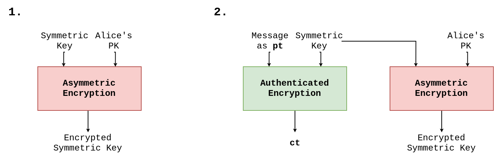
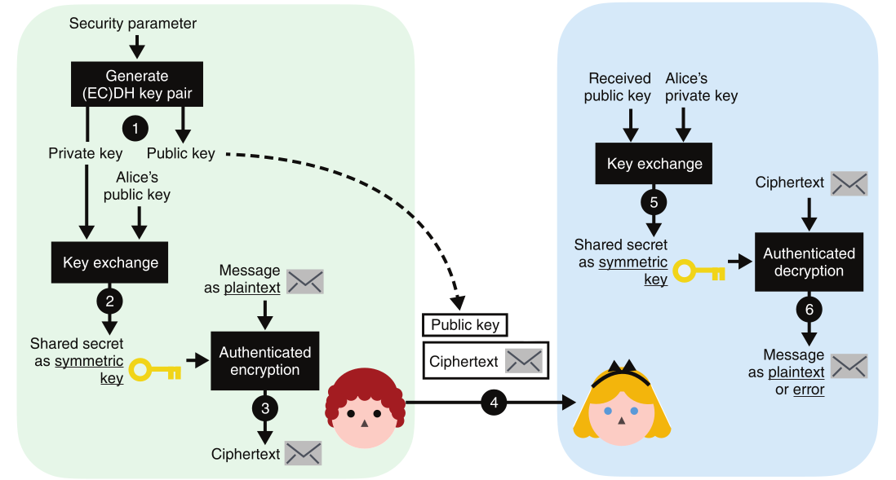

# Asymmetric & Hybrid Encryption
**Problemi**:
* è limitata dalla lunghezza massima del messaggio da cifrare
* la velocità computazione della cifratura/decifratura asimmetrica è molto più lenta se confrontata con quella asimmetrica => **math operation** $\neq$ **bits manipulations**

## Key Exchange and Key Encapusaltion$^1$
Questa tipologia di protocollo è nata utilizzando RSA, ma adesso è preferito ECDH al suo posto:
* sono state scoperte molte vulnerabilità nelle implementazioni di RSA e negli standard
* attrattività di ECDH di avere dei parametri di sicurezza molto più piccoli

## Hybrid Encryption$^2$
Combinazione di crittografia asimmetrica e *authenticated encryption*.

[**Tink**](https://github.com/tink-crypto): libreria crittografica sviluppata da google, disponibili wrapper per vari linguaggi di programmazione.

=> `ECIES_P256_HKDF_HMAC_SHA256_AES128_GCM`: standard per l'*hybrid encryption* gestisce in maniera trasparente lo standard crittografico: ***Elliptic Curve Integrated Encryption Schema***

### AES-OAEP
RSA si basa sul problema della fattorizzazione di numeri molto grandi: $n = p \cdot q$, *textbook RSA* ha un sacco di problemi.

=> **PKCS#1 v1.5**: definisce un padding che aggiunge un numero random di bytes al messaggio. **PROBLEMA**: ***Bleichenbacher's million message attack*** (*CCA2: adaptive chosen-ciphertext attack*), gradualmente è possibile rivelare il contenuto di un messaggio cifrato RSA. Con questa funzione di *padding* i testi in chiaro vengono riempiti con un formato fisso che deve essere seguito. Se il dispositivo di decifrazione rivela in qualche modo il *padding* è valido, funge da oracolo che rileva informazioni sulla chiave privata. Trovare l'intera chiave segreta richiede l'invio di diversi milioni di testi cifrati di "prova" al bersaglio. L'idea è quella di intecettare un messaggio cifrato, modificarlo (attraverso la proprietà omomorfica di RSA), continuare l'invio (verso il destinatario) e aspettare la prova di decifrazione. Se durante la decifrazione il *padding* rimane valido allora è possibile ottenere delle informazioni. 
Dopo alcune modifiche e *patch* sono state trovate altre vulnerabilità sopra di esse:
* 2018: ***Return of Bleichenbacher's Oracle Threat (ROBOT)***
* 2023: the ***Marvin Attack***

=> **RSA-OAEP (Optimal Asymmetric Encryption Padding**: non è vulnerabile per costruzione, in quanto ha una proprietà: ***Plaintext-Awareness***. È la proprietà che rende difficile per un attaccante di creare un *ciphertext* valido per la decifrazione. Dentro alla costruzione **OAEP** è presente un componente chiamato ***MGF*** che si basa su una **XOF (eXtendable Output Function)**  . **PROBLEMA**: ***Manger's Padding Oracle Attack*** permette di decifrare messaggi senza sapere la chiave segreta. Va sfruttare un'implementazione errata di **RSA-OAEP** che permette all'attaccante di validare (tramite delle *query* ad un oracolo) il *padding*.

### ECIES

=> **AE** necessita di chiavi **uniformemente random**, lo scambio di chiavi [EC]DH non fornisce chiavi con questa proprietà => l'output viene dato in pasto ad un **KDF** o **XOF**
