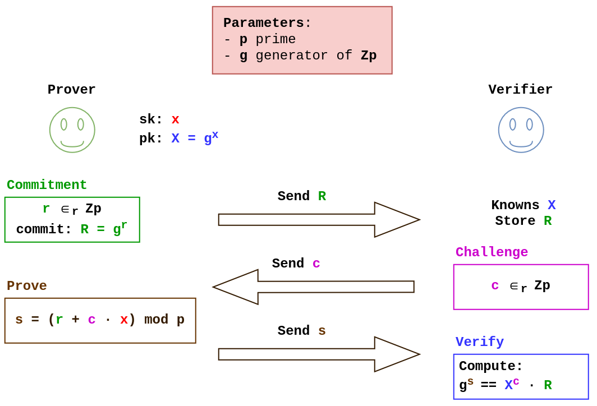
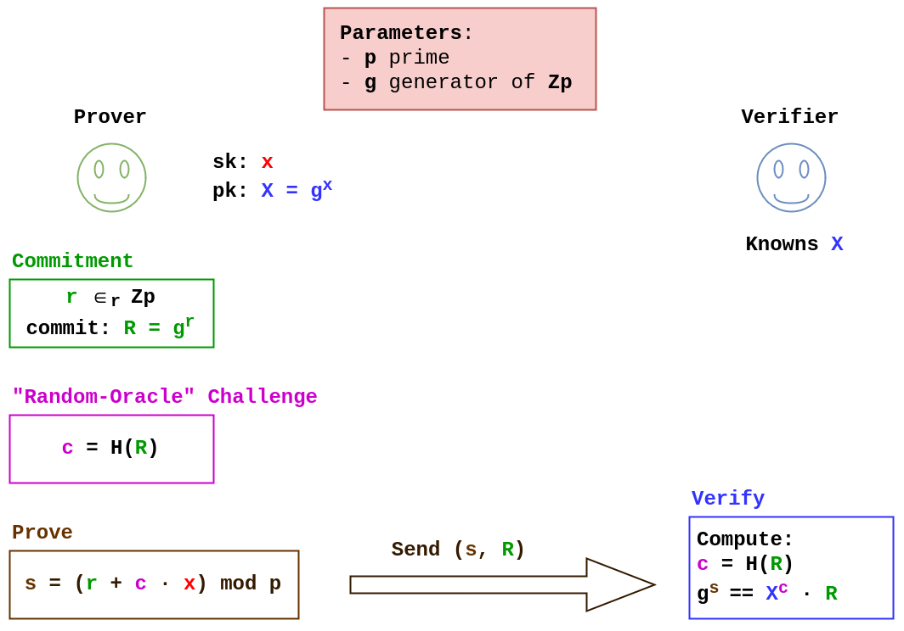
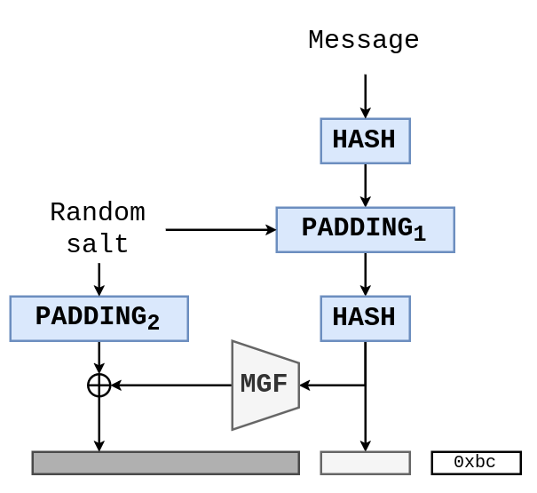
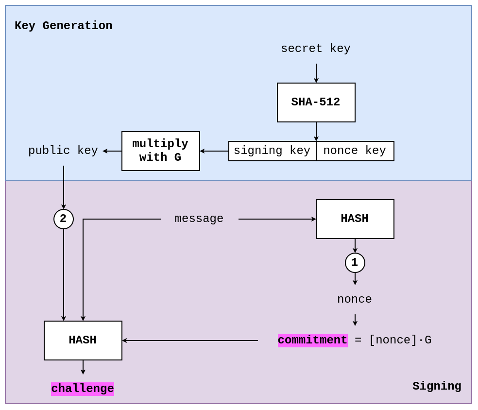
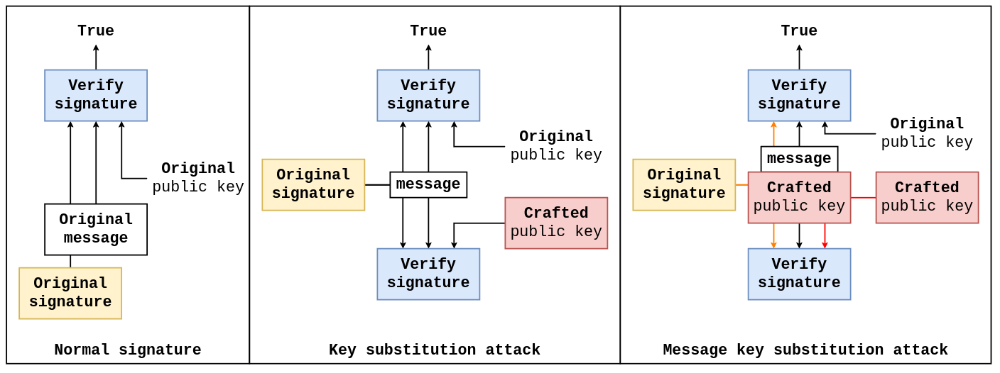

# Signature e Zero Knowledge Proof
**PRORIETÀ**:
* solo io posso utilizzare la mia firma per firmare i messaggi
* tutti quanti possono verificare la mia firma

SIGNATURE SCHEME pipeline:
* generazione di una coppia di chiavi asimmetriche (pubblica e privata)
* un algoritmo di firma che prende come input: chiave privata e messaggio; e da come output una firma
* un algoritmo di verifica che prende come input: chiave pubblica, messaggio e firma; e da come output un errore se la firma non è validata

*sk* $\Rightarrow$ *signing key* &emsp; *pk* $\Rightarrow$ *verify key*

Gli algoritmi di firma permetto di validare l'**origine del messaggio** e l'**integrità** di esso.

$\equiv$ MAC ma senza la condivisione pregressa di una chiave segreta => in maniera asimmetrica.

Con i **signature scheme** è possibile definire gli ***Authenticated Key Exchange*** che sono resistenti ad attaccanti del tipo MITM attivo, come ad esempio in uno scambio chiave di DH. L'autenticazione delle parti può essere si univoca che bi-univoca (=> **mutually-authenticated key echange**). È possibile comporre degli schemi di **Public Key Infrastructure** delegando la verifica dell'identità di un attore a un attore con maggiore autorità (in senso gerarchico).

## Zero Knowledge Proof
**Schnorr Identification Protocol**: è un sistema zkp interattivo che segue un pattern a 3 step (*commitment*, *challenge* e *proof*) è anche noto come **sigma protocol** ($\Sigma$ *protocols*)

In questa circostanza è presente una proprietà di sicurezza nota come: **Honest Verifier Zero Knowledge (HVZK)** se la challenge viene scelta in maniera randomica (il *verifier* è onesto) allora la segretezza del segreto è mantenuta. La garanzia di sicurezza "più alta" è la **Full Zero Knowledge**, il protocollo di Schnorr nonostante non rispetti matematicamente questa proprietà, ad oggi, non è stata trovata nessuna costruzione di **c** per la quale il *verifier* riuscisse ad estrapolare delle informazioni della chiave segreta (sk) del *prover*. Il **problema** di questo protocollo (e in generale dei protocolli interattivi) è che aggiungono *overhead* non-negligibile perché viene richiesto lo scambio di messaggio (spesso sulla rete) e quindi aggiunge *unbounded delays*, infatti in crittografia applicata sono praticamente assenti. => **Fiat Shamir heuristic (trasformation)** che rende questo protocollo non interattivo.

La *random challenge* (anche noto come **transcript**) può includere diverse informazioni:
* **R**: è il commit oscurato 
* **m**: è il messaggio e permette di costruire su una ZKP un *signature scheme*
* **X**: è la chiave pubblica e garantisce l'autenticità del mittente

Alla fine la *random challenge* sarà nella forma **c = H(X || R || m)**

## Signature Scheme
* **DSA**: variante della firma di Schnorr
* **ECDSA**: basa le operazioni matematiche su EC
* **EdDSA**: *Edwards-curves DSA* => stato dell'arte in termini di firma digitale per applicazioni reali.

### RSA PKCS#1 v1.5
`RSAES-PKCS1-V1_5` $\neq$ `RSASSA-PKCS1-V1_5`

**RSA PKCS#1 v1.5** può essere utilizzata anche come algoritmo di firma, ma nel 2006 **Bleichenbacher** ha messo a putno un'attaco del tipo: **signature forgery** basandosi sullo stesso principio del *million padding oracle*. È un *probabilistic signature scheme* $\cong$ **FDH: Full Domain Hash**

### ECDSA
*k* è un **nonce** e deve essere **unico**, **impredicibile** e **segreto** (*ephemeral key*) => se anche solo una di queste condizioni non è rispettata è possibile ricostruire la chiave segreta di firma.

Nel 2013 Playstation 3 utilizzava ECDSA, ma ripetendo i nonce. [link](https://www.spark.money/glossary/nonce-reuse). Esistono in letteratura delle tipologie di attacchi chiamati *lattice attack* che data la conoscenza/leak di pochi bit del nonce è possibile ricostruire la chiave privata. => *total break*. La **soluzione** si basa su ***Deterministic ECDSA*** genera il *nonce* in base al messaggio e alla chiave privata.

### EdDSA

È basato sugli algoritmi di Schnorr, ed è un algoritmo **deterministico** (=> [*twisted Edwards-curves*](https://en.wikipedia.org/wiki/Twisted_Edwards_curve): una tipologia di curva ellittica che permette l'implementazione di interessanti ottimizzazioni).
* *Edwards25519*: garantisce sicurezze a 128 bit
* *Edwards448*: garantisce 224 bit di sicurezza

La curva *Edwards25519* è definita come i punti che soddisfano l'equazione: $-x^2 +y^2 = 1 + d \times x^2 \times y^2 \mod p$, dove:
* $d$ è un numero molto grande
* $x$ e $y$ sono dei valori $\mod p$ dove $p = 2^{255}-19$ (lo stesso valore della curva *Curve25519*)

[**RFC 8032**](https://www.rfc-editor.org/info/rfc8032/) definisce tre varianti di EdDSA che utilizzano *Edwards25519*:
* **Ed25519**: è quello base
* **Ed25519ctx**: introduce una stringa custom obbligatoria; quasi mai utilizzata questa variante nella pratica. L'unica differenze è che per ogni chiamata hash viene aggiunto un prefisso scelto dall'utente
* **Ed25519ph**: inserisce un blocco hash sul messaggio prima della firma

L'aggiunto di una `custom_string` è molto comune in crittografia perché partendo da una stessa chiave privata è possibile dividere i contesti in cui viene utilizzata (soprattutto nelle KDF) => *domain separation*

## Sicurezza

### Substitution Attack
*Substitution attacks* (*duplicate signature key selection*):
* *key substitution attacks*
* *message key substitution attack*

I *substitution attacks* sono figlio di un gap tra la crittografia teorica e quella applicata. Normalmente le firme in crittografia sono analizzate in modo da rispettare il vincolo di siscurezza: **EUF-CMA (Existential Unforgeability Under Adaptive Chosen Message Attack)**. In questo modello, viene generato un *key pair*, e richiesto di firmare un numero arbitrario di messaggi. Nel mentre un attaccante osserva le firme prodotte, l'attaccante vince se in un certo istante $t$ riesce a produrre una firma valida di un messaggio che non ha ancora visto (normalmente in questo *security game* l'attaccante è lo stesso che richiede la firma di messaggi arbitrari). Sfortunamente, EUF-CMA, non riesce a validare alcuni *corner-case* e certi attacchi (come i *substitution attacks*) non vengono considerati.

### Signature Malleability
Molte *signature scheme* sono ***malleable***: se mi fornisci una firma valida, posso modificarla e farla diventare una nuova firma differente, ma comunque valida. Anche non conoscendo la *signing key* sono capace di creare una firma valida. *Non-malleability* non implica necessariamente che la firma è unica (a differenza delle *verifiable random function* che fanno affidamento sull'unicità della firma, come altri schemi che garantiscono a parità di messaggio la stessa firma).

***Strong EUF-CMA (SUF-CMA)***: cerca di includere nella definizione di EUF-CMA la non-malleabilità (o resistenza alla malleabilità).
