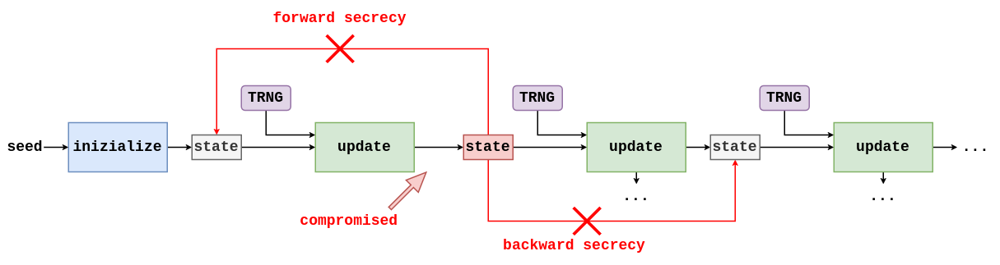
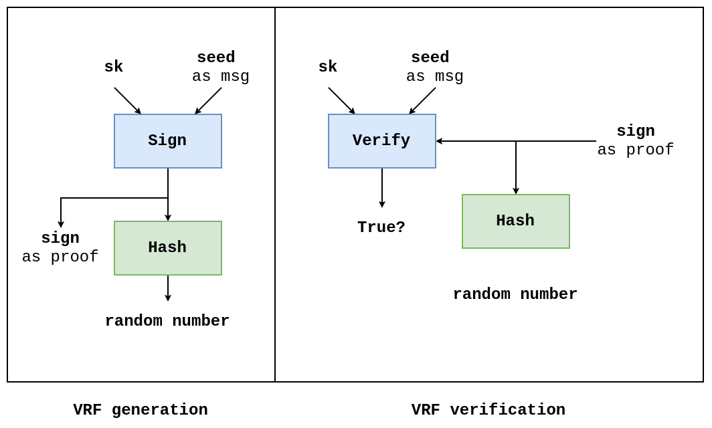

# Randomness and Secret
Il bottone `RAND` sulle calcolatrici non era un vero e proprio generatore di numeri random, quando nel *firmware* della calcolatrice veniva hardcodata una lista di numeri. Un generatore di numeri casuali deve scegliere un numero da una distribuzione uniforme (**uniform distribution**) ovvero che sono distribuiti in egual proporzione.

Per la **crittografia** la proprietà di essere **uniformemente distribuiti** non è sufficiente a definire la bontà del numero generato, ma devono anche garantire la proprietà di **impredicibilità**. => è quindi normale utilizzare fenomeni fisici *hard-to-predict*.

Le condizioni iniziali di uno stato fisico e la loro mutazione nel tempo sono note all'interno della ***chaos theory***. Cloudflare utilizza un [**LAVARAND**](https://en.wikipedia.org/wiki/Lavarand) ovvero dispongono di un'intera parete di *lava lamp*, quando vengono fotografate hanno stati sempre diversi e permettono di generare un *hard-to-predict shapes of wax*

Applicazioni reali: il sistema operativo è colui che fornisce *randomness* utilizzabile. Ha una **entropy source** (sorgente di entropia).

## TRNG: True Random Number Generator
* utilizza il rumore (*noise*) per estrarre entropia dai fenomeni fisici. È un processo che può essere lento (*randomness extraction*)
* molte applicazioni hanno bisogno di numeri random molto velocemente e quindi può diventare un *bottleneck* ([**ASLR**](https://en.wikipedia.org/wiki/Address_space_layout_randomization) e TCP)

SOLUZIONI: **PRNG** ovvero **Pseudo Random Number Generator**, per funzionare necessitano di un *seed* che inizializza la serie di selezione di randomicità.

`PRNG` $\neq$ `CSPRNG` (**Cryptographically Secure PRNG**) $\neq$ `DRBG` (**Deterministic Random Bit Generator**)

## PRNG: Pseudo-Random Number Generator
* **Deterministica**: partendo dallo stesso `seed` la serie di numeri random deve essere ripetuta.
* **Indistinguibile dal random**: permette di garantire che non venga mai esposto lo stato interno della *black box*.
* Una PRNG deve simulare la scelta del numero in modo che rispetti il ***uniformly at random***.
* **Forward Secrecy**: se lo stato interno della PRNG viene compromesso, bisogna garantire che gli stati precedenti non possano essere ri-calcolati (=> è spesso utilizzato di solito una *hash function* in quanto grazie alla sue caratteristiche garantisce proprio questo vincolo).
* **Backword Security**: è necessario curare lo stato interno per non permettere ad un attaccante che ha ottenuto lo stato interno di predirre i risultati futuri.

[**Dual-EC PRNG**](https://en.wikipedia.org/wiki/Dual_EC_DRBG) => Geratore che presentava una backdoor rivelata da Snowden.


## Applied Random
* **noise source**: raccolta da fenomeni fisici impredicibili
* **cleaning and mixing**: unione di sorgenti differenti
* **prng**: utilizzo i due medoti precedenti (trng) come `seed` per inizializzare una PRNG

Linux => PRNG basato su ChaCha20, MacOS => PRNG basato su SHA-1, Windows => `BCryptGenRandom` è una `syscall` utilizzata per generare numeri random.

Su Linux e MacOS esiste un file `/dev/urandom` che è una fonte di valori random.
```bash
$ dd if=/dev/urandom bs=16 count=1 2>/dev/null | xxd -p
8eb64fcf44e26b16805ccdb98362cd17
```

=> può avere un entropia bassa quando il sistema è avviato da poco tempo.

`random number` $\neq$ `cryptographyically strong random number`. Per la seconda è consigliabile utilizzare delle *kernel PRNG* (invece che quelle *userland*) [CVE-2008-0166](https://security-tracker.debian.org/tracker/CVE-2008-0166) caso di studio dove OpenSSL generava in maniera errata numeri random.

* **forking process**: il processo padre e figlio (nel caso in cui si usi una *userland PRNG*) condividono lo stesso stato interno.
* **virtual machine**: quando si va a clonare delle VM, si può clonare anche lo stato interno della PRNG.
* **early boot entropy** (istruzione [DRAND](https://en.wikipedia.org/wiki/RDRAND) per risolvere il problema)

=> fare sempre meno affidamento su algoritmi che necessitano di randomicità (`AES_GCM_SIV`, `EdDSA`)

## Public Randomness
* **one-to-many**: produrre randomness per altri
* **many-to-many**: un gruppo di parteipanti vuole produrre randomness insieme

### VRF: Verifiable Random Function
Costrutto che permette di generare randomicità per altri ma facendo in modo che non sia alterabile ([**BLS**](https://en.wikipedia.org/wiki/BLS_digital_signature))


### Decentralize Randomness Beacon
In alcuni scenari un gruppo di persone vogliono estrarre randomicamente un vincitore tra di loro (lotteria). Viene utilizzato una *threshold distributed key* ovvero una che permette di produrre una firma per un dato messaggio solo dopo che un certo numero di partecipanti (*threshold*) hanno firmato il messaggio (non tutti).

## Key Derivation Function
* non necessitano di avere come input un *uniformly random number* (l'importante che dispongano di sufficiente entropia)
* è utilizzata da protocolli che richiedono ai partecipanti di derivare la propria chiave molteplici volte (deterministico)
* non è progettata per produrre molti valori random
* la più comune è la *HMAC-based key derivation function* anche nota come (**HKDF**)

Normalmente è composta da due componenti:
* **HDKF_extract**: rimuove bias dal segreto in input, producendo un *uniformly random secret*, inoltre accetta un input chiamato *salt* (permette *domain separation*)
* **HKDF_expand**: produce un segreto uniforme di lunghezza arbitraria, presenta un input chiamto *info*

=> PROPRIETÀ: **related output**

è possibile utilizzare anche funzioni hash, che però non permettono la *domain separatio* ad eccezione di **SHA-512**, che può essere utilizzata come **KDF** per generare due chiavi a 256 bit (partendo dall'output dell'hash e dividendolo a metà)

## Key Management
* **key rotation**: associando ad ogni segreto un data di scadenza, e sostituendo le chiavi periodicamente è possibile sanare eventuali compromissioni
* **key revocation**: in alcuni casi non vuoi aspettare che la chiave venga rotata, ma vuoi revocarla perché è stata manomessa

### Secret Sharing
L'idea è quella di dividere un segreto (chiave simmetrica, chiavi di firma, ecc...) in parti, tante quanti il numero di partecipanti. L'idea è stata poi implementata da Shamir (co-autore di RSA) e chiamato **Shamir Secret Sharing (SSS)** dove una persona chiamata *dealer* genera un segreto e lo divide in $n$ parti. Quando poi è necessario ricostruire il segreto, i vari partecipanti daranno la parte privata al *dealer* che sarà incaricato di ricostruire la chiave. L'idea matematica è quella dell'[**interpolazione di Lagrange**](https://en.wikipedia.org/wiki/Lagrange_polynomial). 

Questo algoritmo è centralizzato sul *dealer*, il che lo rende un *single point of failure* in quanto se si riesce a rubare il segreto quando è ricostruito è meno brigoso.
=> *multi-signature* => aggiunge un grosso *overhead* => comprimere più firme in una => *signature aggregation* (**BLS**)

Questa parte della crittografia si chiama **Distributed Key Generation (DKG)** e fa parte del ramo della crittografia chiamato **Secure Multi-party Computation (MPC)**, questo permette di escludere il *dealer*, ma sono direttamente i $n$ partecipanti a fare uno scambio chiavi.
