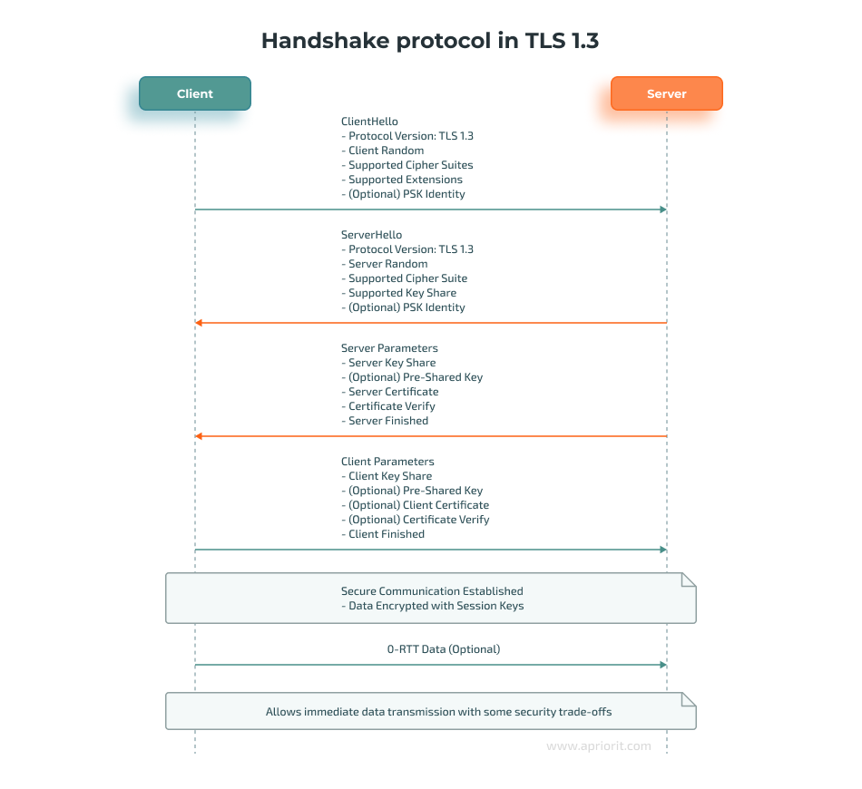
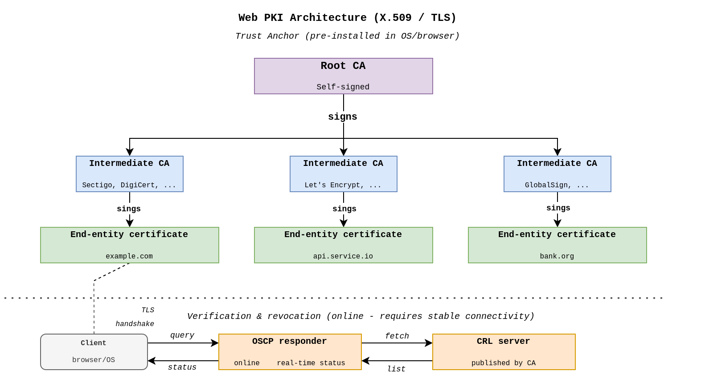
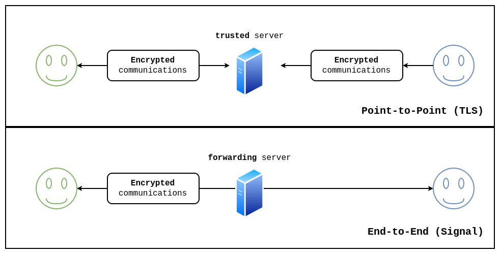
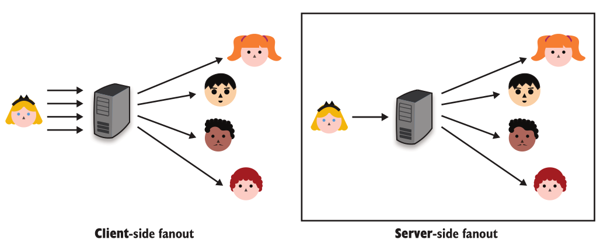
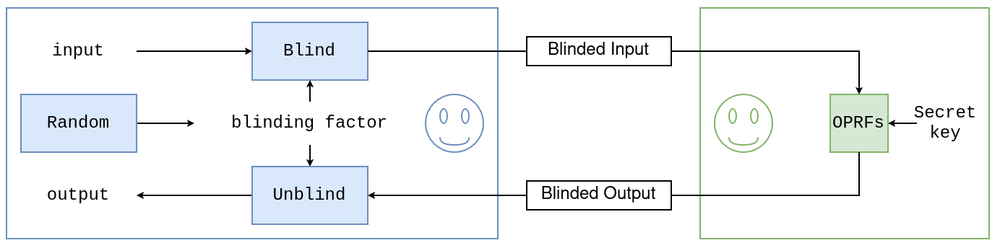
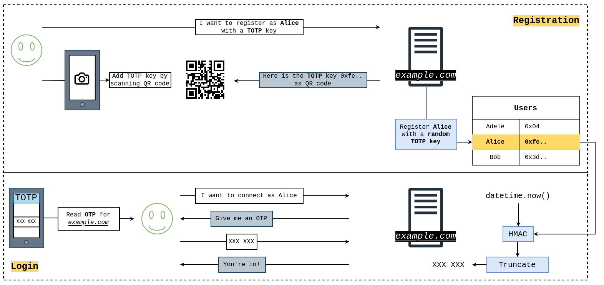

# Protocols

## Secure Transport

### Secure Socket Layer
SSL (Secure Scoket Layer) è la versione precedente di TLS (Transport Layer Security) deprecata dopo la versione 3.0 per via di vulnerabilità di progettazione e per colpa di algoritmi crittografici deprecati ([**RFC 7457**](https://www.rfc-editor.org/info/rfc7457/))

**TLS** è nato come protocollo di internet, ma ad oggi viene utilizzato per scenari diversi. `TLS` $\neq$ `DTLS`: 
* **TLS** è costruito sopra TCP
* **DTLS** è costruito per UDP (`D` è per *datagram*)

TLS è diviso in due parti: *handshake phase* e *post-handshake phase*

1. **Handshake**:
    * **negoziazione**: viene definito l'intervallo delle versioni di SSL e TLS accettate e gli algoritmi crittografici supportati. viene trovato la configurazione comune tra *client* e *server*
    * **scambio delle chiavi**
    * **autenticazione delle parti** (può essere *mutually authentication* o *one-way authentication*)
    * **session resumption**: evita di ripetere tutto il procedimento nel momento che è già presente una sessione attiva. Può essere impostata usando i `SESSION_TICKET`

Attacchi basati su DOWNGRADE delle versione: [FREAK](https://freakattack.com/), [LOGJAM](https://en.wikipedia.org/wiki/Logjam_(computer_security)), [DROWN](https://en.wikipedia.org/wiki/DROWN_attack).

Attacchi basati su implementazioni non corrette: [LUCKY13](https://en.wikipedia.org/wiki/Lucky_Thirteen_attack), Bleichenbacher's CRYPTO'98, [Heartbleed](https://en.wikipedia.org/wiki/Heartbleed) Bug 2014

in TLS 1.3 lo scambio delle chiavi è *ephemeral* che permette di garantire **forward secrecy**. In TLS 1.3 è anche presento il *record padding* che permette di nascondere la lunghezza del ciphertext, è un parametro configurabile; mentre usando PSKs (Pre-Shared Keys) è possibile utilizzare il meccanismo **Early-Data** o **0-RTT** (non sicurissimo). 

Dopo le operazioni di `ClientHello` e `ServerHello` TLS 1.3 cifra il resto delle richieste/risposte, è possibile utilizzare le PSKs che può essere inviata durante il `ClientHello` tramite un *PSKs Identifier* per evitare una nuova **key exchange**. È presente anche un campo `random` che garantisce nel `KDF` predicibilità nella generazione delle chiavi.

**HTST (HTTP Strict Transport Secruity)**: forza la connessione con un certo sito solo tramite HTTPs, impedendo qualsiasi tentativo di connessione in chiaro. Le richieste `GET` in TLS 1.3 sono **idempotenti** per evitare *side-channel attack*.

NTP e DNS non sono cifrate. 

per evitare che il client debba fare una richiesta in HTTP a OCSP (Online Certificate Status Protocol), spesso viene inclusa dentro alla risposta di autenticazione del server. (OCSP stampling -> cert + OCSP status per la richiesta dei certificati durante la latenza della richiesta dei certificati per l'autenticazione)

### Noise protocol framework
[**Noise framework**](https://noiseprotocol.org/) è un framework crittografico per creare protocolli di comunicazione sicuri basato sullo scambio di segreti di Diffie-Hellman che permette di collassare la complessità della comunicazione (*overhead*) alla fase di design. (*continuosly authenticates its handshake transcript*)

## End-to-End Encryption
TLS ha per design necessità di *trusted thrid part* (ovvero la necessità di host di cui ci si fida per poter continuare la comunicazione) questo porta la comunicazione a poter passare attraverso molti hop che possono osservare il traffico: *middlebox*. Alcune delle quali che mettono "fine" a TLS (*terminate TLS*).

| GOOD | BAD |
|:----:|:---:|
| filtrare il traffico | intercettare le comunicazioni |
| bilanciamento delle connessioni | registrare le comunicazioni |
| | spiare comunicazioni |

Nel 2015 Lenovo vendeva i PC con delle CAs che iniettavano delle ADV nelle pagine web. [link](https://en.wikipedia.org/wiki/Superfish#Lenovo_security_incident)

La crittografia *end-to-end* gioca un ruolo fondamentale nel garantire la confidenzialità e la privacy degli utenti finali.
* *out-of-band mechanism*: per creare fiducia e autenticazione utilizzare metodi al di fuori della rete (vita reale). Non sempre possibile

PGP o GPG: **web of trust (WOT)**: decentralizzazione della fiducia. (s/MIME: utilizza CAs) vengono entrambi utilizzati sopra a SMTP. ([**EFAIL**](https://efail.de/))

[**SALTPACK**](https://saltpack.org/) è un sostituto di PGP. Invece di estendere le email (s/MIME) estende i messaggi, utilizzando come base [**XMPP**](https://xmpp.org/)**(eXtensile Messaging and Presence protocol)**. Garantisce la proprietà di **deniability** ovvero i destinatari dei messaggi e gli osservatori passivi non possono utilizzare i messaggi che ha inviato il mittente in tribunale. => cifrati e autenticati utilizzando crittografia simmetrica. 

PGP utilizzando crittografia asimmetrica invece la proprietà di **non ripudio**, ovvero un mittente non può negare di aver mandato un messaggio firmato con la sua chiave privata.

[**Signal Protocol**](https://signal.org/docs/)
* [**X3DH**](https://signal.org/docs/specifications/x3dh/): scambio di chiavi
* [**Double Ratchet**](https://signal.org/docs/specifications/doubleratchet/)
    * **Symmetric-key ratchet**: garantisce *forward secrecy* su ogni messaggio
    * **DH ratchet**: garantisce *post-compromise secrecy*

Il protocollo di **Signal** utilizza per l'autenticazione l'approccio **TOFU** (Trust of First Use): ovvero assume che durante la prima comunicazione tra due entità non avvenga nessuna intromissione attiva (*active MITM*)

**Altri protocolli End-to-End**: [**Matrix**](https://matrix.org/) - *client-side fanout* - e [**MLS**](https://www.rfc-editor.org/rfc/rfc9420.html) **(Message Layer Security)** - *server-side fanout*.

## Authentication
Autenticazione può essere di due tipologie:
* *message*/*payload authentication* (**authenticity** o **integrity**): il messaggio è genuino e non è stato modificato dalla sua creazione
* *origin*/*entity*/*identity authentication*: pemette di provare l'identità di una certa entità (*identity authentication*)

Abbiamo già visto diverse metodi di autenticazione: *PKIs*, *TOFU* e *WOT*. 
* *user authentication*: come degli umani vengono identificati da dei servizi
* *user-aided authentication*: come gli umani possono aiutare due servizi ad autenticarsi tra di loro.

`ALICE` $\equiv$ `PROVER`

### User Authentication
Per l'autenticazione di utenti su dei servizi è sufficente utilizzare il *password hashing* (hashing con salt), utilizzando magari un altoritmo ottimizzato per rallentarne il *brute-force*, ad esempio **Argon2**?

Lo riutilizzo delle password è una vulnerabilità nota anche nell'ambito del *social engineering*, ogni anno vari esperti di sicurezza dicono che le password sono morte, ma è ancora uno dei metodi più utilizzati per autenticasi. Nonostante questo è necessario ricordare che:
* gli utenti sono incapaci ad inventare delle password
* ricordarsi molte password è difficoltoso

Alcune SOLUZIONI potrebbero essere:
* **Single Sign-On (SSO)**: (*one password to rule them all*) utilizzare un servizio di autenticazione per autenticarsi su altri servizi
* **Password Manager**: delegare la memorizzazione della password ad uno *storage* cifrato

#### SSO
Permette agli utenti di autenticarsi a vari servizi fornendo l'autenticazione tramite un servizio terzo (account)
* **Security Assertion Markup Language 2.0 (SAML)** utilizza XML encoding
* **OpenID Connect (OIDC)**: è un'estensione di **OAuth** ([RFC 6749](https://www.rfc-editor.org/info/rfc6749/)) un protocollo di autenticazione che utilizza JSON encoding

SAML -> *enterprise* -> *legacy protocol*

OIDC -> utilizzato per tutto

Per l'utilizzo di entrambi è necessario fare molta attenzione in fase di autenticazione, infatti una malconfigurazione può portare a delle vulnerabilità: nel maggio del 2020 SSO di Apple è risultato compromesso, bastava una query all'enpoint del server che gestiva l'ODC per risultare autenticati tramite Apple. [link](https://bhavukjain.com/blog/2020/05/30/zeroday-signin-with-apple)

Anche utilizzando **SSO** o **password manager** viene ridotto il numero di password, ma non viene rimosso il loro utilizzo.

### PAKE
* *aPAKE: Asymmetric* (o *augmented*) *password authenticate key exchange*: permette a degli utenti di identificarsi a dei servizi senza inviare direttamente la propria password
* *Symmetri* (o *balance*) *PAKE*: entrambi i servizi conoscono la password

**aPAKE**: *Secure Remote Password (SRP)* definito nell'[RFC 2944](https://www.rfc-editor.org/info/rfc2944/) e poi aggiunto a TLS nell'[RFC 5054](https://www.rfc-editor.org/info/rfc5054/) per l'autenticazione di autenticazione. Questo protocollo ha alcuni problemi legati alla sua storicità (creato per la prima volta negli anni 2000), se nella fase di registrazione un MITM intercetta la comunicazione, esso può impersonificare la vittima. Altre problematiche: incompatibile per la crittografia su curve elittiche e non è supportato da TLS 1.3

Nel 2019 la CFRG ha avviato un processo di selezione per la selezione di nuovi algoritmi PAKE (sia *asymmetric* che *balance*):
* **CPace** e **SPAKE2**: *symmetric or balance PAKE*
* **OPAQUE** e **AuCPace**: *oblivious (asymmetric) PAKE* si basa sulle **Oblivious Pseudo-Random Function**

### OPRFs
In termini crittografici *oblivious* si riferisce generalmente a protocolli in cui una parte esegue un'operazione crittografica senza conoscere l'input fornito da un'altra parte

Ad esempio: Alice vuole farci cifrare un'informazione da Bob senza che Bob conosca il messaggio e Alice conosca la chiave segreta.
* Alice converte il suo input $x \in \mathbb{Z}_p$
* Alice genera randomicamente un `blinding_factor` $r \in_r \mathbb{Z}_p$ 
* Alice calcola $\text{blinded_input} = x^r$ e lo invia a Bob
* Bob calcola $\text{blinded_output} = \text{blinded_input}^k$, dove $k \in \mathbb{Z}_p$ è la chiave segreta e invia `blinded_output` ad Alice
* Alice può *unblinding* l'output calcolando $\text{blinded_output}^{1/r} = \text{blinded_output}^{r^{-1}} = x^{r \cdot k \cdot r^{-1}} = x^k$

OPAQUE ([RFC 9807](https://datatracker.ietf.org/doc/rfc9807/)) utilizza questo costrutto per costruirci sopra un'autenticazione.

#### Da aggiungere informazioni su OPAQUE e SPAKE2 (PAKE)
vedi slide e appunti CPA

[OPAQUE](https://datatracker.ietf.org/doc/rfc9807/) è basato su *standard DH groups*, può essere deployato con ECC attraverso l'assunzione una funzione chiamata: [**hashing-to-curve**](https://datatracker.ietf.org/doc/rfc9380/) (può essere deployato con Argon2). La password non viene conosciuta dal server e il salt non viene mai conosciuto dal client.

### One-Time Password
L'idea dietro all'autenticazione su OTP è quella di derivare sicurezza dalla conoscenza di un chiave simmetrica (*uniformly random*) lunga o 16 o 32 bytes invece che segreti a bassa entropia come le password. Questa chiave simmetrica permette di generare un OTPs *on demand*.

`OTP` $=$ $F($`symmetric_key`, `additional_data`$)$

Esistono due implementazioni di *OTPs-based authentication*:
* **HMAC-based OTP (HOTP)**: standardizzato nell'[RFC 4226](https://www.rfc-editor.org/info/rfc4226/). Gli `additional_data` in questo caso è un counter => *client* e *server* devono condividere uno stato comune.
* **Time-based OTP (TOTP)**: standardizzato nell'[RFC 6238](https://datatracker.ietf.org/doc/html/rfc6238). Gli `additional_data` in questo caso è il *time*

La maggior parte delle applicazioni utilizzano `TOTP` perché `HOTP` richiedono che il client e il server si salvino lo stato (il *counter*). La memorizzazione dello stato può portare a dei problemi se uno dei due lati si disallinea, causando che nessuna delle due parti può produrre (o validare) OTP a meno che non vengano ri-allineati.

### FIDO2
Nell'ambito della crittografia asimmetrica, possiamo utilizzare diversi metodi per autenticare il server:
* utilizzare la nostra chiave asimmetrica all'interno del *key exchange* per autenticare il proprio lato della connessione
* utilizzare la nostra chiave asimmetrica all'interno di una connessione già sicura con un server autenticato

Per il primo è, ad esempio, possibile utilizzare TLS per autenticare *server side*, nel caso in cui anche il server volesse autenticare il client (*mutually authentication in key exchange*) viene inviato al client un messaggio del tipo `CertificateRequest` message da parte del server.

**Post-handshake User authentication with FIDO2**: viene utilizzata una connessione sicura dove solo il server è autenticato verso il client. In questo caso il server può semplicemente chiedere di firmare una *random challenge*; in questo modo si vanno a prevenire attacchi di tipo *reply*. Uno standard utilizzato in questo ambito è **Fast IDentity Online 2 (FIDO2)**. Utilizza per lavorare unicamente *hardware authenticators* per prevenire la possibilità di *phishing*. 

* [**Client to Authenticator Protocol (CTAP)**](https://developers.yubico.com/CTAP/): è il protocollo che governa la comunicazione tra il dispositivo client e l'autenticatore vero e proprio. CTAP2 permette chiavi di sicurezza esterne (es. USB, NFC o BLE) o ad autenticatori integrati (*Windows Hello* o *Face ID*) di dialogare con il browser.
* [**Web Authentication**](https://developers.yubico.com/WebAuthn/): definisce come il browser o il sistema operativo comunicano con il servizo verso su autenticarsi. WebAuthn gestisce la creazione delle credenziali e la verifica durante il login.

L'idea generare è quella di unire al metodo di autenticazione tramite password una tra: OTPs e FIDO2, questo approccio viene chiamato **MFA: Multi-factor authentication**.

### User-aided Authentication

**CPace: Composable Password Authenticated Connection Established** l'idea:
* due *device* derivano un elemento di un gruppo ciclico basandosi su una password comune (noti il generatore e il primo)
* i due *device* eseguono uno scambio effimero di DH

Alcune terminologie importanti:
* **SAS: Short Authenticated String**
* **Manually Authenticated Diffie-Hellman (MA-DH)** 

Tre tipologie per collegare due device:
* scambio di chiavi pubbliche *out-of-band*, per poi eseguire un scambio di segreti
* l'utente può immettere la stessa password su due *device* differenti così che possano effettuare un *symmetric PAKE* 
* un utente può verificare un *fingerprint* dello scambio di chiave a scambio terminato in modo da validare che nessun MITM si sia intercettato durante il *pairing*
