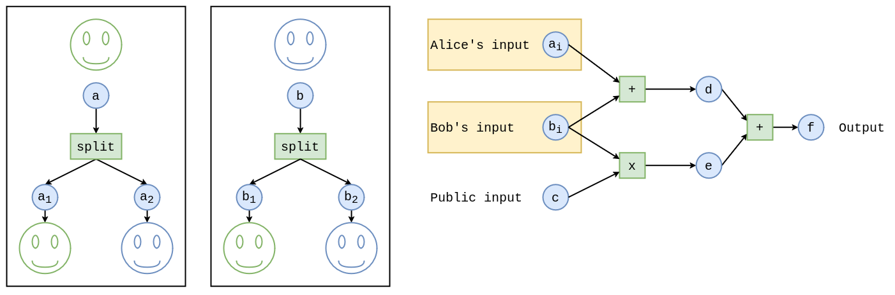

# Future Cryptography
* **Secure Multi-Party Computation (MPC)**: Un sottocampo della crittografia che consente a diversi partecipanti di eseguire un programma congiuntamente senza necessariamente rivelare al programma i propri input
* **Fully Homomorphic Encryption (FHE)**: una primitiva che permette di eseguire operazioni arbitrarie su testo cifrato
* **General-Purpose Zero-Knowledge Proof (ZKPs)**: primitiva che permette di provare che conosci qualcosa senza rivelarla, applicata a sistemi più complessi.

## MPC


*threshold cryptography* => [**Shamir Secret Sharing**](https://en.wikipedia.org/wiki/Shamir%27s_secret_sharing)

Mira a risolvere (generalmente) il problema che Alice e Bob hanno una lista di parole e vogliono sapere quali parole (o almeno il numero di) che hanno in comune. => possiamo utilizzare una OPFR

=> *Private Set Intersection (PSI)*

Un'altra alternativa è quella chiamata [**Garbled Circuit**](https://en.wikipedia.org/wiki/Garbled_circuit)

### Shamir Secret Sharing
Casi usi più comuni: (i) condividere una chiave per decifrare la *root key* di un password manager, (ii) recuperare una *user key* per accedere a mail cifrate, (iii) condividere delle *passphrase* utilizzabili per ricreare un *master secret* per accedere ad un *wallet* e (iv) ricostruire la combinazione per una cassaforte fisica.

**Proprietà**: (i) garantisce *information-theoretic security*, (ii) ogni parte del segreto non eccede la dimensione del dato originale, (iii) per ogni *threshold*, le parti del segreto possono essere dinamicamente aggiunte o cancellate senza influire sulle parti condivise, (iv) la sicurezza del sistema può aumentare senza cambiare il segreto, ma ruotando il polinomio occasionalmente (mantenendo costanti i *free term*) e ruotando le parti del segreto date ad ogni partecipante e (v) in organizzazioni in cui la gerarchia è importante è possibile dare parti diverse del segreto.

**Debolezze**:
* **no verifiable secret sharing**: Durante il processo di ricomposizione del segreto, lo schema SSS non offre un metodo per verificare la correttezza di ciascuna quota utilizzata. La condivisione verificabile del segreto (Verifiable Secret Sharing) mira a verificare che i detentori delle quote siano onesti e non forniscano quote contraffatte.
* **single point of failure**: il segreto deve esistere in un posto dove deve essere diviso e ricostruito. 

è possibile rimuovere il *single point of failure* attraverso tre primitive:
* invece di avere un *Dealer* che possiede l'intero segreto e lo divide, si utilizza un protocollo chiamato **Distributed Key Generation (DKG)**
* per ovviare alla ricostruzione del segreto in un "singolo host" è possibile utilizzare o le [**Threshold Signature (TSS)**](https://www.binance.com/en/academy/articles/threshold-signatures-explained) o la **Multi-Party Computation**

Il principio matematico dietro è quello dell'[**interpolazione di Lagrange**](https://en.wikipedia.org/wiki/Lagrange_polynomial)

SSS viene anche chiamato $(k, n)$-*threshold scheme* basato su interpolazione lineare su *finite field*. L'idea è quella di dividere un segreto $\mathcal{S}$ in $n$ pezzi del dato $\mathcal{S}_1, ..., \mathcal{S}_n$ noti come *shares* in modo che:
* la conoscenza di almeno $k$ shares $\mathcal{S}_i$ permette la ricostruzione di $\mathcal{S}$. L'intero segreto può essere ricostruito con una qualunque combinazione di $k$ shares.
* L'intero segreto non può essere ricostruito con un numero inferiore a $k$ di shares.

se $n = k$ servono tutti gli shares per ricostruire il segreto.

Assumiamo che il *master secret* $\mathcal{S}$ può essere rappresentato come l'elemento $a_0$ di un $GF(q)$ (dove $q$ è maggiore del numero $n$ di shares). Vengono scelti randomicamente $k-1$ elementi $a_1, ..., a_{k-1}$ da $GF(q)$ e ci costruiamo sopra il polinomio: $f(x) = a_0 + a_1x + a_2x^2 + a_3x^3 + ... + a_{k-1}x^{k-1}$. Dopo possiamo calcolare $n$ punti presi sulla curva, ad esempio, considerando $i=1, 2, ..., n$, troveremo $P_i(i, f(i))$. Ad ogni partecipante è dato un punto. Dato un sottoinsieme di $k$ coppie $a_0$ può essere calcolato con la formula di interpolazione:

$a_0 = f(0) = \underset{j=0}{\overset{k-1}{\sum}}y_j \; \underset{m=0 \; m \neq j}{\overset{k-1}{\prod}}\frac{x_m}{x_m - x_j} $

Per il calcolo sia del segreto che dell'equazione è possibile utilizzare sia l'interpolazione di lagrange che la *barycentric form*. Consideriamo la *Lagrange interpolation* su un certo punto $x$:

$P(x) = \underset{j=0}{\overset{k-1}{\sum}}y_j \cdot \ell_j(x)$

Dove il polinomio $\ell_j(x)$ è definito come $\ell_j(x) = \underset{m \neq j}{\prod} \frac{x - x_m}{x_j - x_m}$. 

Invece di lasciare la produttoria spezzata, andiamo a definire il *polinomio nodo* $\ell(x) = \underset{m=0}{\overset{k-1}{\prod}} (x - x_m)$, dividendo questo termine per il singolo termine $(x - x_j)$ si riottiene esattamente il numeratore della formula di Lagrange.

A questo punto isoliamo il denominatore della formula di Lagrange definendolo come **barycentric weight** $w_j$:

$w_j = \underset{m \neq j}{\prod} \frac{1}{x_j - x_m} = \underset{m \neq j}{\prod} (x_j - x_m)^{-1}$

Sostituendo queste due definizioni, il nostro polinomio di base $\ell_j(x)$ si trasforma:

$\ell_j(x) = \ell(x) \cdot \frac{w_j}{x - x_j}$

sostituendo questa definizione alla formula lagrangiana per l'interpolazione di un punto $x$:

$P(x) = \underset{j=0}{\overset{k-1}{\sum}} y_j \cdot \ell(x) \cdot \frac{w_j}{x - x_j} = \ell(x) \cdot \underset{j=0}{\overset{k-1}{\sum}} y_j \cdot \frac{w_j}{x - x_j}$

possiamo estrapolare il termine $\ell(x)$ perché non dipende da $j$, questa è la **First Barycentric Form**

Per calcolare $f(0)$, ovvero il segreto condiviso di SSS, calcolare ogni volta $\ell(x)$ per ogni iterazione è computazionalmente costoso, se noi poniamo $P(x) = y_j = 1$ in questo modo è possibili isolare $\ell(x)$:

$\ell(x) = \frac{1}{\sum_{j=0}^{k-1} \frac{w_j}{x - x_j}}$

Se andiamo a sostituire alla **prima forma baricentrica** il termine $\ell(x)$ andremo ad ottenere:

$P(x) = \ell(x) \cdot \underset{j=0}{\overset{k-1}{\sum}} y_j \cdot \frac{w_j}{x - x_j} = \frac{\sum_{j=0}^{k-1} y_j \cdot \frac{w_j}{x - x_j}}{\sum_{j=0}^{k-1} \frac{w_j}{x - x_j}}$ 

E questa viene chiamata **Second Barycentric Form**


### Garbled Circuit
[link](https://en.wikipedia.org/wiki/Garbled_circuit)


## Homomorphic Encryption
È definito come il santo graal della crittografia, è una forma di cifratura che permette l'esecuzione di operazioni sul testo cifrato (che saranno poi valide anche nel testo in chiaro) senza dover decifrare l'informazione. Questa primitiva permette di garantire la privacy delle informazioni salvate. Esistono vari livelli di crittografia omomorfica:
* **Partially Homomorphic Encryption**: comprende schemi che supportano la valutazione di circuiti costituiti da un'unica porta logica, ad esempio: somma o moltiplicazione.
* **Somewhat Homomorphic Encryption**: supportano la valutazione di due porte logiche: somma e moltiplicazione.
* **Leveled Fully Homomorphic Encryption**: supporta la valutazione di circuiti arbitrari composti da più tipologie di porte logiche, ma con una **profondità limitata**.
* **Fully Homomorphic Encryption**: consente la valutazione di circuiti arbitrari composti da più porte logiche con profondità illimitata.

### DGHV
van Dijk, Gentry, Halevi, Vaikuntanathan

L'idea alla base di questo schema è nascondere un bit (0, 1) dentro un multiplo di un numero segreto, aggiungendo un po' di "rumore", per sicurezza.
* **Chiave segreta ($p$)**: un numero intero dispari molto grande
* **Testo in chiaro ($m$)**: il messaggio, che può essere solo un bit (0 o 1)
* **Rumore ($r$)**: un numero intero casuale piccolo
* **Maschera ($q$)**: un numero casuale molto grande

La cifratura di un bit $m$ è: $c = q \cdot p + 2r + m$

Mentre la decifratura avviene: $m = (c \text{ mods } p) \mod 2$

* mod $2$: è il resto della [divisione euclidea](https://en.wikipedia.org/wiki/Euclidean_division) per $2$
* mods $p$: anche noto come *symmetric mod*: 
$a \text{ mods } p = \left\{ \begin{array}{rr} a \text{ if } a \leq (p-1)/2 \\ a - p \text{ if } a > (p-1)/2 \end{array} \right.$ 

```python
def symmetric_mod(a: int, p: int) -> int:
    r = a % p
    if r > (p - 1) // 2:
        r -= q

    return r 
```

Sapendo che la cifrature è $c = q \cdot p + 2r + m$, adiamo a definire la parte rumorosa come $E = 2r + m$, avremo quindi che: $c = q \cdot p + E$, affinché la decifratura funzioni e il modulo restituisca il valore corretto, l'errore $E$ deve rimanere strettamente minore di $p/2$ ($E < \frac{p}{2}$), ovvero deve essere la distanza dal multiplo di $p$ corretto $(q \cdot p)$:
* se $E < p / 2$: il multiplo più vicino a $c$ rimane $q \cdot p$. L'operazione restituisce $E$ intatto.
* se $E > p / 2$: il testo cifrato $c$ "sconfina" e si avvicina al multiplo $p$ successivo ovvero $(q + 1) \cdot p$, rompendo $E$.


#### Porta XOR (Addizione)
$c_1 + c_2 = (q_1 \cdot p + E_1) + (q_2 \cdot p + E_2) = (q_1 + q_2) \cdot p + (E_1 + E_2)$

In questo caso è una crescita molto lineare, se si fanno 10 addizioni il rumore diventerà $10 \times E$

#### Porta AND (Moltiplicazione)
$c_1 \cdot c_2 = (q_1 \cdot p + E_1) \cdot (q_2 \cdot p + E_2) = p(q_1q_2p + q_1E_2 + q_2E_1) + E_1E_2$

Il nuovo rumore sarà: $E_1 \cdot E_2$, se lo sviluppiamo:

$E_1 \cdot E_2 = (2r_1 + m_1) \cdot (2r_2 + m_2) = 4r_1r_2 + 2r_1m_2 + 2r_2m_1 + m_1m_2 = 2(2r_1r_2 + r_1m_2 + r_2m_1) + m_1m_2$
anche in questo caso la struttura $2($rumore$) + m$ è intatta e quindi è possibile decifrare correttamente il cifrato. Il problema è la crescita dell'errore che in questo caso è esponenziale.


#### Parametri
Il rumore $r$ deve essere piccolo. Non può essere troppo piccolo ($\approx \in [2, 3]$ bit), un attaccante potrebbe tentare di indovinarlo con un attacco *brute force* o usare un attacco noto come **Approximate GCD** per trovare $p$. $r$ deve avere una lunghezza in bit simile al livello di sicurezza. Per 128 bit di sicurezza, $r$ è un numero scelto a caso che ha circa 128 bit. (chiamiamo il numero di bit di sicurezza $\lambda$)

Consideriamo per ora $\lambda \approx 128$ bit.

La chiave segreta $p \approx \lambda^2$ (dipende dal circuito) infatti la grandezza di $p$ definisce quanto spazio vitale ha il rumore prima di sconfinare la soglia di $p/2$. Infatti se si parte con un rumore a 128 bit avremo:
* dopo una moltiplicazione (AND): il rumore che diventa 256 bit
* dopo due moltiplicazioni a cascata avremo il rumore che diventa 4096 bit.

La maschera $q \approx \lambda^5$ bit. Questa è la vera ragione per cui il DGHV è infattibile, la maschera maschera $q$ deve "sommergere" i dati, una maschera più piccola permetterebbe ad algoritmi avanzati come il LLL di estrarre il segreto $p$ analizzando molti testi cifrati.

#### Bootstrapping
**manca - da guardare**

### Asymmetric DGHV

#### Param
* $\rho = \omega(\log \lambda) \approx \lambda$ sono i bit di sicurezza che si vogliono impostare all'algoritmo
* $\overline{\rho} = \rho + \omega (\log \lambda) \approx 2 \cdot \lambda$ è la lunghezza massima in bit dei rumori $r_i$
* $\eta \geq \rho \cdot \Theta (\lambda \log^2 \lambda) \approx \overset{\sim}{\mathcal{O}}(\lambda^2)$ è la lunghezza in bit della chiave segreta
* $\gamma = \omega(\eta^2 \log \lambda) \approx \overset{\sim}{\mathcal{O}}(\lambda^5)$ è la lunghezza in bit di ogni intero della chiave pubblica
* $\tau \geq \gamma + \omega(\log \lambda) \approx \gamma + \lambda$ indica il numero di elementi necessari per la chiave pubblica

#### Key Generation
* $p = sk \leftarrow \text{ getPrime}(\eta)$ è la nostra chiave segreta
* $pk = \{ pq_i + r_i, \; r_i \in_{\text{R}} (-2^{\rho}, 2^{\rho}) \quad i \in \mathbb{N}_{\tau} \}$ bisogna verificare che $x_0 = pk[0]$ abbia 3 caratteristiche:
    * $x_0 \geq pk[i], \; i \in [1, ..., \tau]$
    * $x_0 \mod 2 = 1$
    * $x_0 \text{ mods } p \mod 2 = 0$

Così avremo $p$ come chiave privata e $pk$ come chiave pubblica

#### Encrypt(b)
* $S \subset_R pk \; | \; \#S \in [1, ..., \tau)$
* $r \in_R (-2^{\overline{\rho}}, 2^{\overline{\rho}})$
* il *ciphertext* sarà: $c = b + 2r + \sum_{i \in S}x_i \mod x_0$

#### Decrypt
Per decifrare $m = (b \text{ mods } p) \mod 2$. Verifichiamo il corretto funzionamento della *decrypt*
$$
\begin{align*}
    c &= (b + 2r + \sum_{i \in S}x_i) + kx_0 \\
    &= (b + 2r + \sum_{i \in S}(p \cdot q_i + 2r_i)) + k(p \cdot q_0 + 2r_0) \\
    &= b + 2r + \sum_{i \in S}(p \cdot q_i) + \sum_{i \in S}2r_i + k \cdot p \cdot q_0 + 2kr_0 \\
    &= b + 2r + \sum_{i \in S}2r_i + 2kr_0 + \sum_{i \in S}(p \cdot q_i) + k \cdot p \cdot q_0 \\
    &= b + 2(r + kr_0 + \sum_{i \in S}r_i) + p(k \cdot q_0 + \sum_{i \in S}q_i)
\end{align*}
$$

A questo punto sostituiamo
$$
\begin{align*}
    m &= \left[ \left( b + 2(r + kr_0 + \sum_{i \in S}r_i) + p(k \cdot q_0 + \sum_{i \in S}q_i) \right) \text{ mods } p \right] \mod 2 \\ 
    &= \left[ \left( b + 2(r + kr_0 + \sum_{i \in S}r_i) + \cancel{p(k \cdot q_0 + \sum_{i \in S}q_i)} \right) \cancel{\text{ mods } p} \right] \mod 2 \\
    &= \left( b + \cancel{2(r + kr_0 + \sum_{i \in S}r_i)} \right) \cancel{\mod 2} = b
\end{align*}
$$
